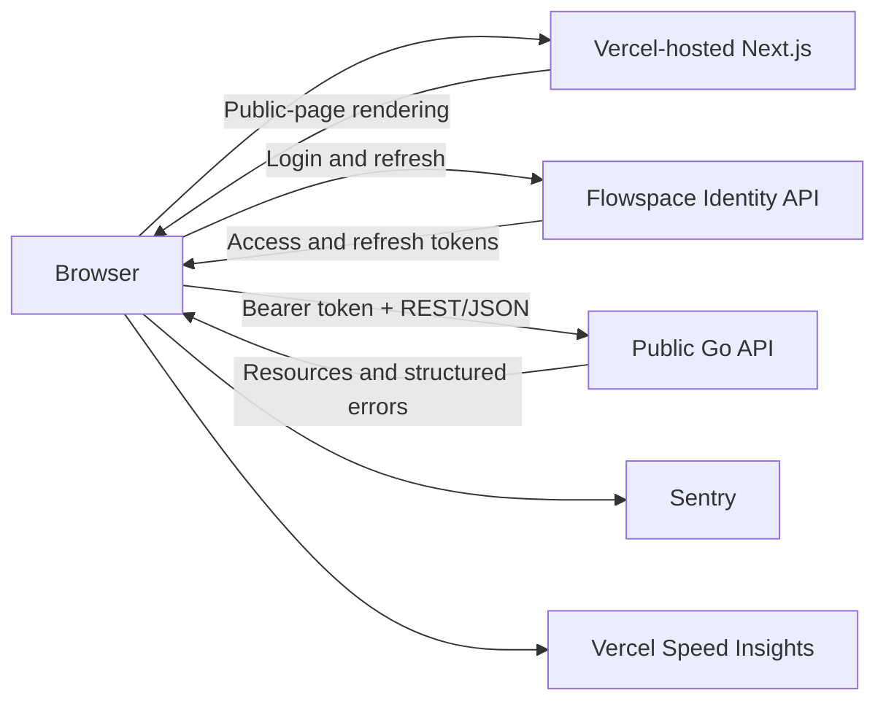

# Architecture

Status: accepted direction with implementation proposals still open.

Updated: 2026-11-06.

This document defines frontend boundaries, browser behavior, API consistency, delivery, and learning evidence. Accepted rationale lives in the [Architecture Decision Records](adr/README.md) index. Replaceable tools live in the [Technology stack](technology-stack.md).

## Goal and constraints

Build the browser application for FlowSpace while learning production-grade frontend engineering.

- Initial product: authentication, workspaces, memberships, projects, tasks, comments, and in-app notifications.
- Repository: standalone frontend repository; backend contracts and documentation remain canonical in the backend repository.
- Application framework: Next.js App Router with strict TypeScript.
- Rendering: public pages may render on the server; authenticated application screens render in the browser.
- Integration: the browser calls the public Go REST/JSON APIs directly.
- Identity: Flowspace Identity owns browser authentication; Go services own authorization.
- Delivery: Vercel hosts previews and production; Go services, including Flowspace Identity, remain on self-hosted infrastructure.
- Cost: hosted development services should remain within personal, non-commercial free tiers.

The frontend improves usability but is never an authorization boundary. A hidden or disabled control does not replace backend enforcement.

## Product experience rules

### Workspaces and access

- The active workspace is visible whenever the user is inside the authenticated application.
- Navigation and actions reflect the user's known workspace role, while denied API responses remain authoritative.
- Switching workspace clears workspace-scoped server state before loading the next workspace.
- Invitation acceptance redirects through authentication when necessary and preserves the intended destination.
- Revoked or missing access produces an explicit access-denied state rather than an empty resource view.

### Tasks and collaboration

- Tasks expose To Do, In Progress, and Done states and may move between any of them.
- A task displays at most one assignee.
- Task content, status, and assignment mutations send the version last read by the browser.
- A stale write never silently overwrites newer data; the interface reloads the task and asks the user to retry or reconcile.
- A successful task mutation does not imply that its notification has already arrived.

### Async states

- Every data surface defines loading, empty, error, forbidden, and retry behavior where applicable.
- Submissions prevent accidental duplicate actions while preserving safe retry after an ambiguous failure.
- Background refresh does not replace visible data with a full-page loading state.
- Destructive or ownership-changing actions require clear intent and show the resulting state.

## Frontend boundaries

| Boundary | Owns | Must not own |
| --- | --- | --- |
| App Router | Routes, layouts, metadata, public rendering, and navigation | Go business logic or workspace authorization |
| Authenticated client shell | Session readiness, protected navigation, and session lifecycle | Credential collection or authorization decisions |
| API transport | Base URL, bearer header, deadlines, idempotency headers, and error decoding | Feature-specific cache policy or UI messaging |
| TanStack Query layer | Remote resource cache, request lifecycle, mutations, and invalidation | Form state or unrelated UI preferences |
| Zustand stores | Cross-component client-only UI state | API resources, form fields, or authentication tokens |
| Form layer | React Hook Form state and Zod client validation | Final validation authority or server cache |
| Shared UI | Locally owned AlignUI-based components and interaction contracts | Page-specific data fetching or business workflows |
| Storybook and MSW | Isolated component states and reusable API scenarios | Production runtime behavior |

Keep state in the narrowest owner that works: component state first, then URL state for shareable navigation, TanStack Query for server state, and Zustand only for remaining cross-component client state.

## Routing and rendering

- App Router route groups separate public, authentication-callback, and authenticated application layouts.
- Public pages may use Server Components and server rendering when it improves initial delivery or metadata.
- Components that depend on authentication tokens, TanStack Query, Zustand, browser APIs, or interactive forms are client components.
- Protected route guards wait for session initialization before deciding whether to render or redirect.
- Server middleware and layouts may improve navigation but do not authorize workspace access.
- Route parameters identify requested resources; they never prove tenant membership or role.
- Filters, search, pagination position, and selected views use URL state when a copied or refreshed URL should preserve them.

## Identity and browser security

- Authenticate through the Flowspace Identity public API. The frontend collects passwords in its own forms and sends them only to Identity.
- Keep access and refresh tokens in memory and do not persist them in local storage, session storage, IndexedDB, or non-HttpOnly cookies.
- The frontend holds no client secret.
- Clear authenticated query data and user-scoped client state during logout or identity change.
- Authentication claims may guide presentation, but backend responses determine authorization.
- Allow only required frontend, API, monitoring, and asset origins in CORS and Content Security Policy configuration.
- Values exposed to browser code are public configuration. Secrets never use a public environment-variable prefix or enter the client bundle.
- Monitoring excludes tokens, authorization headers, form contents, and unnecessary personal data.

## API and state consistency

### Contracts and transport

- Protobuf remains the backend source of truth; the frontend consumes the OpenAPI generated from the public annotations.
- `openapi-typescript` generates transport types. The frontend does not maintain parallel handwritten API resource types.
- One small Fetch wrapper owns the API base URL, JSON handling, bearer header, caller deadline, request correlation, and structured-error decoding.
- List screens use the backend's bounded page size and opaque page token; they do not infer offsets or total counts.
- Create operations that require idempotency generate a key once and reuse it for the same logical retry.
- Mutation retries are enabled only when the operation is naturally idempotent or protected by the required idempotency key.

### Server state

- Query keys include every scope that changes the resource, beginning with workspace and resource identifiers.
- Mutations update or invalidate only affected queries after a successful response.
- Background refetch, stale time, and retry policy are explicit per resource class when defaults are unsafe.
- Optimistic updates require a rollback path and are introduced only when the interaction benefits measurably.
- Workspace or identity changes clear data that the next context must not observe.

### Error behavior

| Condition | Frontend behavior |
| --- | --- |
| Invalid input | Map structured field errors into the form and keep the user's input. |
| Unauthenticated | Attempt supported token renewal, then return to the login screen if needed. |
| Forbidden | Show an access-denied state and remove stale privileged actions. |
| Not found | Show a resource-specific not-found state. |
| Version conflict | Reload current data and require deliberate retry or reconciliation. |
| Rate limited or temporarily unavailable | Preserve context and offer a bounded retry. |
| Unknown server failure | Show a stable error state with a support correlation value when available. |

## UI system and accessibility

- Tailwind tokens define shared color, typography, spacing, elevation, radius, and motion decisions.
- Copy only the AlignUI components the product uses; copied source becomes locally reviewed and maintained code.
- Reusable components keep semantic HTML, keyboard behavior, focus management, accessible names, and visible focus states intact.
- Forms pair labels, descriptions, and errors programmatically and do not rely on color alone.
- Dialogs, menus, popovers, and drag interactions remain operable without a pointer.
- Motion respects the user's reduced-motion preference.
- Storybook covers reusable component variants and meaningful loading, empty, error, disabled, and validation states.
- Automated Axe checks supplement manual keyboard and assistive-technology review.

## Environments and delivery

| Environment | Frontend runtime | Backend target |
| --- | --- | --- |
| Local | Next.js development server | Local Go APIs, including Flowspace Identity |
| Preview | Vercel preview deployment | Approved staging API origin |
| Production | Vercel production deployment | Public production-named API origin |

- Environment-specific public URLs configure API origins; the frontend contains no environment secrets.
- Preview origins require explicit CORS and CSP treatment before they may call staging.
- GitHub Actions runs formatting, linting, type checking, tests, Storybook build, and Next.js build before merge.
- Vercel builds preview deployments for reviewed changes and deploys the production branch.
- Renovate proposes dependency changes for review and never automerges them.
- Production promotion must identify the frontend revision and generated API contract revision used by the build.

## Testing and observability

- Vitest covers non-trivial logic; React Testing Library covers user-visible component behavior.
- MSW supplies reusable success and failure scenarios for component tests and Storybook.
- Storybook verifies shared components independently of live backend availability.
- Playwright covers a focused set of critical browser workflows against production-like boundaries.
- Accessibility automation runs at component and critical-page levels.
- Sentry records release-tagged browser failures and usable source maps after privacy filtering.
- Vercel Speed Insights records deployed Core Web Vitals within the selected plan limits.
- Client telemetry failure never blocks navigation, authentication, or API operations.

## Learning evidence

| Increment | Working capability | Required evidence |
| --- | --- | --- |
| 1. Foundation and identity | Public routing, login, callback, logout, and protected application shell | Reload and redirect flows work; tokens are absent from persistent browser storage |
| 2. Workspace and work | Workspaces, projects, tasks, assignments, comments, and role-aware controls | Generated contracts compile; denied actions and structured validation render correctly |
| 3. Consistency and failure | Versioned task mutations, idempotent creates, pagination, and delayed notifications | Conflicts, ambiguous retries, timeouts, and temporary failures preserve user intent |
| 4. UI system | AlignUI-based reusable components and forms documented in Storybook | Keyboard checks, Axe checks, and meaningful component states pass |
| 5. Delivery and operations | CI, Vercel previews, production deployment, error monitoring, and field performance | A failing revision is blocked; a deployed failure can be correlated and diagnosed |

Required failure experiments:

- expire or revoke a session during navigation and during an API request;
- revoke workspace membership while cached workspace data is visible;
- submit two updates from the same task version and reconcile the conflict;
- retry a create after an ambiguous timeout without duplicating the resource;
- make the API unavailable or slow while preserving navigation and form input;
- delay notification delivery after a successful task mutation; and
- load a protected deep link before session initialization completes.

## Open proposals

Keep these here until accepted; then create a focused ADR.

- Route map, layout boundaries, and the exact public-page scope.
- OpenAPI artifact publication, compatibility checks, and generation workflow. The [Backend integration](backend-integration.md) lists the backend gaps that block it.
- Browser session handling: login and signup screens, Google and GitHub login in the browser, token renewal, and session restoration after a reload. [ADR-0025](adr/0025-flowspace-identity-replaces-keycloak-for-browser-authentication.md) leaves these open, and persisting tokens or using cookies needs a record that supersedes [ADR-0007](adr/0007-authentication-tokens-stay-in-memory.md).
- Approved Vercel preview origins.
- CORS, Content Security Policy, and other security-header values per environment.
- TanStack Query defaults for deadlines, stale time, retry, and garbage collection.
- AlignUI source provenance and upstream-update convention.
- Design workflow: where the Penpot design of each feature lives, how a specification links to it, and a mapping from AlignUI components in Penpot to `src/components/ui/` that tells agents which code component implements each design component.
- Sentry filtering, sampling, retention, release naming, and source-map access.
- Supported browser matrix. [`CONSTRAINTS.md`](../CONSTRAINTS.md) sets the accessibility and performance thresholds.
- CI gate ordering and which Playwright checks run before versus after preview deployment.

## Deferred

Not in the initial scope:

- Next.js backend-for-frontend endpoints and backend mutations through Server Actions.
- Server rendering of authenticated data and cookie-based application sessions.
- Offline editing, service-worker caching, and installable PWA behavior.
- Real-time push transport beyond bounded polling or refetch.
- Product analytics, experimentation platforms, and session replay.
- Redux, microfrontends, and separately distributed component packages.
- Copying unused AlignUI components or documenting one-off page sections in Storybook.
